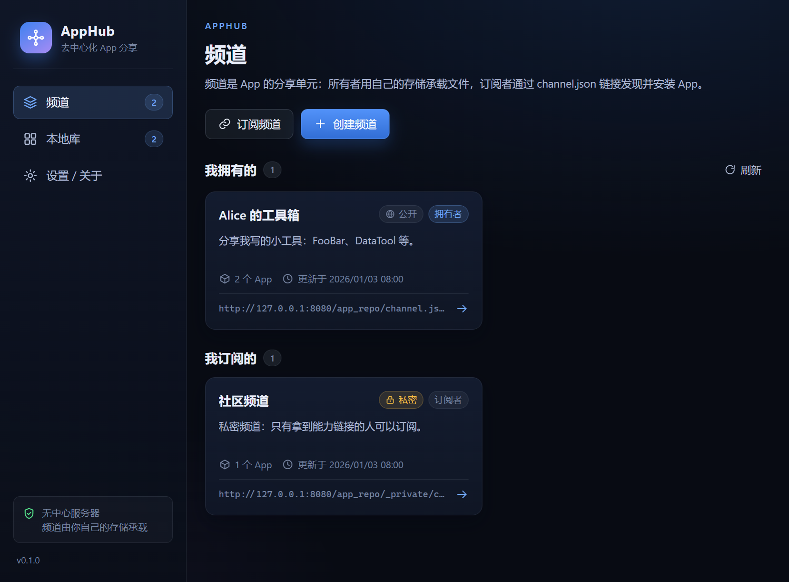
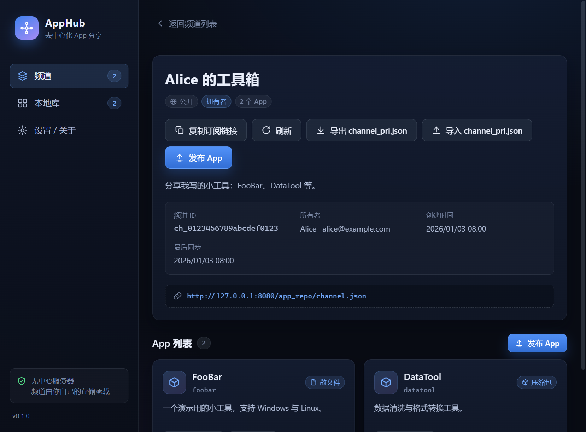
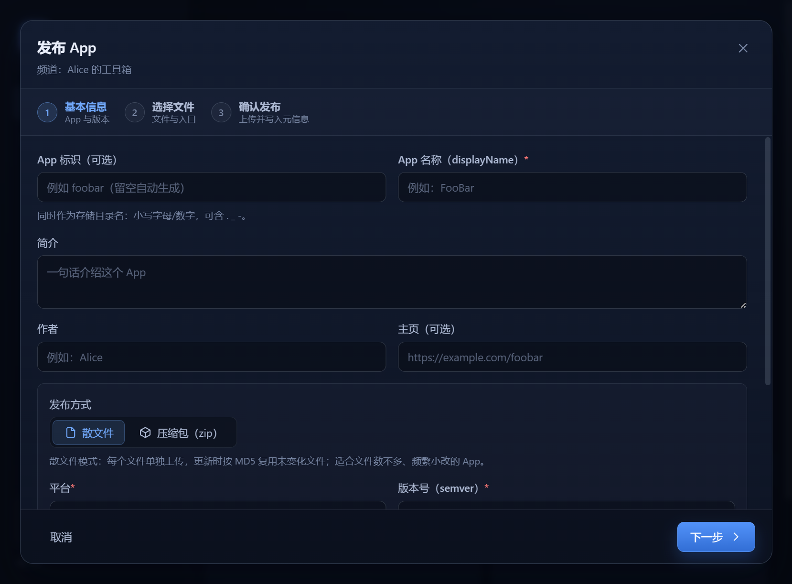
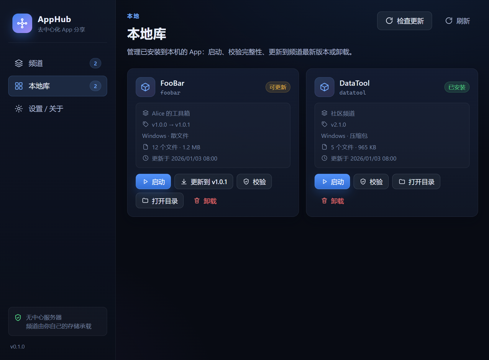
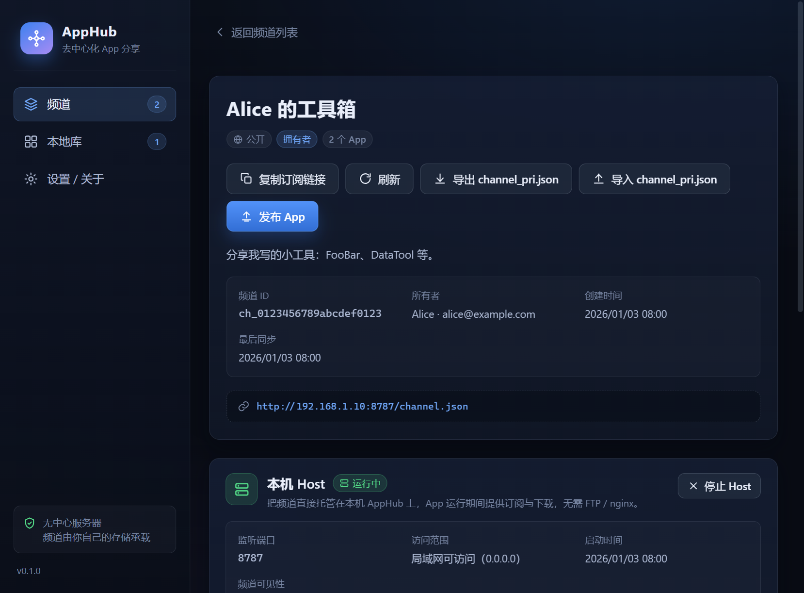
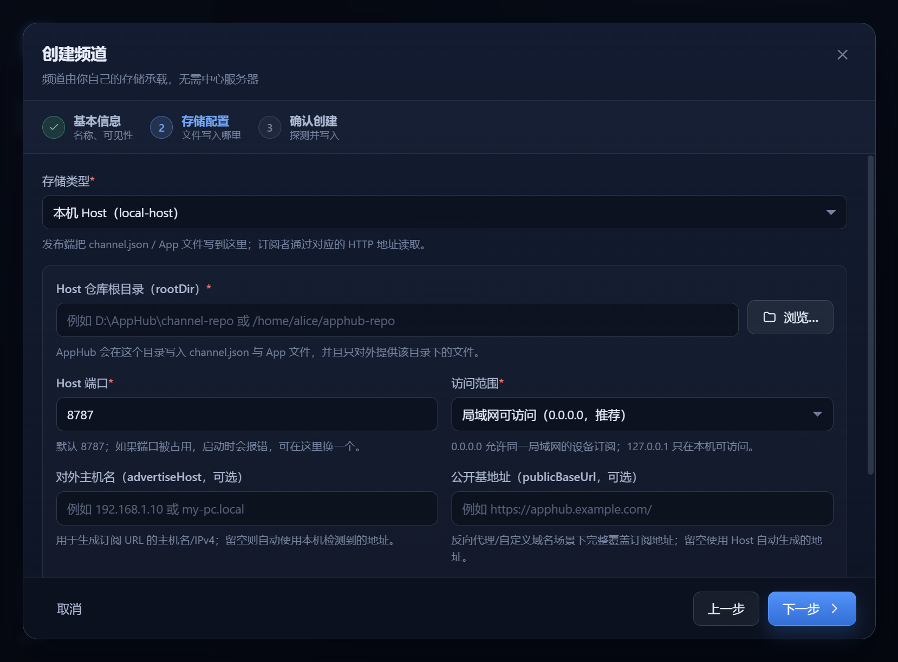

# AppHub

[](https://github.com/Gemini2015/AppHub/actions/workflows/verify.yml)
[](https://github.com/Gemini2015/AppHub/actions/workflows/release.yml)

> 去中心化的 App 分享、订阅与本地管理工具。
>
> 没有中心服务器：频道所有者用自己的存储（FTP + nginx / 本地目录 + 静态服务 / S3 / MinIO）托管 App；
> 任何人拿到 `channel.json` 链接即可订阅公开频道，或凭私密能力链接订阅私密频道。

AppHub 是一个基于 **Electron + React + TypeScript** 的跨平台桌面应用（Windows / Linux / macOS）。

---

## 功能一览

| 需求 | 实现 |
| --- | --- |
| 创建、订阅 App 频道 | 频道向导（公开/私密）、URL 订阅、频道刷新、取消订阅 |
| 每个频道包含若干 App | `channel.json` 登记 App 列表；频道详情页卡片列表 |
| 在频道内发布、下载 App | 发布向导（散文件 / zip 两种方式）、进度条、冲突检测、幂等重试 |
| 管理本地已安装的 App | 本地库：安装、更新、校验（MD5）、启动、打开目录、卸载 |
| AppHub 不存储 App 本身 | 只读写频道所有者配置的存储；本地仅保存已安装副本 |
| 公开频道任何人可订阅/查看/下载 | `channel.json` 公开 URL 直接订阅 |
| 私密频道仅授权用户 | 能力链接（含随机 accessKey 的私密 `channel.json` URL），管理员私下分发 |
| 拥有者/管理员可发布 | 发布权限 = 持有 `channel_pri.json`（可导入/导出给管理员） |
| 远程 channel.json 存储频道信息 | 基础信息 + App 列表 + 元信息 + 下载地址 + 更新方式 |
| 独立 exe / zip / 一组文件 | 散文件发布与 zip 发布两种模式，entry 启动入口 |
| 散文件发布更新 app.meta.json | 每个文件 size + MD5；客户端按 MD5 只下载变化文件 |
| zip 发布更新 app.meta.json | 记录 archive size/MD5；客户端下载 zip → 校验 → 解压覆盖 |
| app.meta.json 含历史版本 + files.json | 每版本完整文件清单；`app.meta.json` 保留全部历史 |
| 频道配置 App 存储 | 创建频道时配置 `local` / `local-host` / `ftp-http` / `s3`（可扩展） |
| 本机 Host 一键分享 | 内置 Host Server 直接托管本地目录，默认监听局域网，生成可分享的 `channel.json` URL，可随时启停 |
| 数据目录可迁移 | 设置中可修改 AppHub 数据目录：复制频道记录/本地库/加密配置到新目录并重启（环境变量固定时只读） |
| FTP + nginx 存储发布 | FTP 上传 + nginx 下载；也支持本地目录/MinIO |
| 完整的测试方案 | 单元 + 集成（进程内 FTP/HTTP/S3 模拟）+ Electron E2E + 手工矩阵，见 [docs/TESTING.md](./docs/TESTING.md) |

## 界面预览

| 频道列表 | 频道详情 |
| --- | --- |
|  |  |

| 发布向导 | 本地库 |
| --- | --- |
|  |  |

| 本机 Host 面板（局域网分享） | 创建 local-host 频道 |
| --- | --- |
|  |  |

> 截图来自真实 Electron 构建产物（960px 窗口，演示数据）。

## 架构

```
┌──────────────────────────── Electron App ────────────────────────────┐
│  Renderer (React UI)  ⇄  preload (contextBridge)  ⇄  Main Process    │
│                                                      │               │
│                        ┌─────────────────────────────┴───────────┐   │
│                        │ @apphub/core                             │   │
│                        │  channels | publishing | library         │   │
│                        └───────┬──────────────────────┬───────────┘   │
│                                │                      │               │
│                     @apphub/storage             本地数据目录            │
│                     local/ftp-http/s3          (安装记录/缓存/密文)      │
└────────────────────────────────┼──────────────────────────────────────┘
                                 │ FTP / S3 / 本地目录写
                                 ▼
              ┌────────── 频道所有者的存储（去中心化）──────────┐
              │  app_repo/                                     │
              │    channel.json                                │
              │    <appId>/app.meta.json                       │
              │    <appId>/<version>/files.json                │
              │    <appId>/<version>/...文件或 zip             │
              └────────────────────────────────────────────────┘
                                 │ nginx / 静态服务 HTTP GET
                                 ▼
                        所有订阅者（下载/更新）
```

详细设计：**[docs/ARCHITECTURE.md](./docs/ARCHITECTURE.md)** · 数据格式：**[docs/PROTOCOL.md](./docs/PROTOCOL.md)** · 存储后端：**[docs/STORAGE.md](./docs/STORAGE.md)** · 测试：**[docs/TESTING.md](./docs/TESTING.md)**

## 快速开始

环境要求：Node.js ≥ 20.19、pnpm ≥ 10（仓库用 pnpm 11 开发）、Windows/Linux/macOS。

```bash
pnpm install        # 安装依赖（会下载 Electron）
pnpm dev            # 开发模式：Vite HMR + Electron
pnpm build          # 构建 out/main、out/preload、out/renderer
pnpm start          # 构建并以生产模式启动
pnpm package        # 用 electron-builder 打包（--dir 产物在 apps/desktop/release）
pnpm dist:win       # 生成 Windows 安装器 AppHub-Setup-*.exe 与免安装 zip（x64）
pnpm test           # 全部单元/集成测试（离线，进程内模拟 FTP/nginx/S3）
pnpm typecheck      # 所有包 TypeScript 严格检查
pnpm verify         # 一键验收：全部 test + typecheck + desktop build
pnpm verify:e2e     # 一键验收（含真实 Electron Playwright E2E，14 步）
pnpm demo           # 无需 GUI 的全链路演示：FTP+nginx 频道 + 本机 Host 频道（创建→发布→订阅→安装→更新/启停）
```

> 开发/测试环境使用 `APPHUB_USER_DATA_DIR` 可整体隔离 Electron userData 与 AppHub 数据（便于多实例与 E2E）；`APPHUB_DATA_DIR` 只隔离 AppHub 数据目录、不影响 Electron 缓存。

## 下载安装（Windows）

从 [GitHub Releases](https://github.com/Gemini2015/AppHub/releases/latest) 下载：

| 资产 | 说明 |
| --- | --- |
| `AppHub-Setup-<版本>.exe` | NSIS 安装器（x64）；可选择安装目录，安装后创建开始菜单/桌面快捷方式和卸载项 |
| `AppHub-<版本>-win-x64.zip` | 免安装版；解压到任意目录后运行 `AppHub.exe` |
| `SHA256SUMS.txt` | 上述产物的 SHA-256 校验值 |

系统要求：Windows 10/11 x64。安装版与免安装版使用同一个 AppHub 数据目录（默认 `<Electron userData>/AppHubData`）。

## 验收结果（本机实测，2026-10-27，含本机 Host 与数据目录设置）

| 项目 | 结果 |
| --- | --- |
| `pnpm verify:e2e`（6 包 test + 6 包 typecheck + build + E2E） | **14/14 步通过，PASS（近期 ~78–97s）** |
| Vitest 单元/集成测试 | **504 个用例，0 skipped**（protocol 27 / storage 56 / core 118 / 集成 37 / desktop 266） |
| Electron E2E（Playwright + 真实 Electron） | **17/17 通过**（启动、订阅→安装→校验→卸载、错误处理、创建/发布向导、本机 Host 创建/启停/URL 可达/私密能力链接、默认 local-host、端口自动避让、数据目录 env/default/custom 三来源与旧版自动迁移） |
| `@apphub/core` 覆盖率（v8，含 HostServer） | statements 85.9% / branches 77.4% / functions 92.3% |
| `pnpm demo`（真实进程内 FTP + 静态 HTTP + 本机 Host） | ftp+nginx 全链路 + **local-host 创建→发布→启动 Host→订阅安装→停止/重启验证** 全部通过 |
| `pnpm package`（electron-builder --dir） | `apps/desktop/release/win-unpacked/AppHub.exe` 生成成功 |
| `pnpm dist:win`（NSIS 安装器 + zip） | `AppHub-Setup-0.1.0.exe`（约 94 MB）、`AppHub-0.1.0-win-x64.zip`（约 134 MB）生成成功，zip 内含 `AppHub.exe` |
| 环境 | Windows / Node 22.23 / pnpm 11.22 / Electron 38.8 / 完全离线 |

> 测试分层、需求覆盖矩阵（R1–R69）、手工验收清单（M1–M34，需要真实 ftp+nginx/MinIO/两台设备局域网/三平台实机/数据目录真实迁移）与 CI 配置见 [docs/TESTING.md](./docs/TESTING.md)。

## 使用指南

### 1. 创建频道（以 FTP + nginx 为例）

准备一台带 FTP 与 nginx 的服务器（或本地用 FileZilla Server/nginx 模拟）：

- FTP 提供一个可写账号，可写入目录 `app_repo/`；
- nginx 将 `app_repo/` 设置为静态目录，例如 `http://your.domain/app_repo/`。

在 AppHub 中点击 **创建频道**：

1. 填写频道名称、描述，选择 **公开** 或 **私密**；
2. 选择存储类型 `FTP + HTTP`，填写：
   - `FTP 主机 / 端口 / 用户名 / 密码 / 根目录`（如 `app_repo/`）；
   - `HTTP 基础地址`（如 `http://your.domain/app_repo/`，即 nginx 的访问地址）；
3. 点击创建。AppHub 会：
   - 探测 FTP/HTTP 可用性；
   - 生成 `channel.json`（公开频道直接写到 `app_repo/channel.json`；私密频道写到 `app_repo/_private/<channelId>/<accessKey>/channel.json`）；
   - 生成 `channel_pri.json`（包含 FTP 凭据），用系统安全存储（Windows DPAPI / macOS Keychain / Linux Secret Service）加密保存在本机；
4. 在频道详情页可 **复制订阅链接** 分享给他人。

> 私密频道：只有拿到订阅链接（内含随机 accessKey）的人才能读取 `channel.json` 与下载 App。
> 发布权限由 `channel_pri.json` 授予：**导出管理员配置** 后私下发送给管理员，对方在 AppHub 中 **导入** 即可发布。

### 1.1 更简单：用「本机 Host」分享（无需 FTP/nginx）

如果 App 就在你自己的电脑上，可以直接用 AppHub 内置的 Host Server（创建频道时**默认存储类型就是本机 Host**）：

1. **创建频道** → 存储类型默认 **本机 Host（local-host）**；
2. 选择/填写一个本地文件夹作为频道仓库目录（`rootDir`）；端口默认从 `8787` 起，**会自动避开已有频道已使用的端口**（如 8787 已被占用则推荐 8788）；
3. 访问范围默认 **局域网可访问（0.0.0.0）**；仅本机调试可切 `127.0.0.1`。首次启动如弹出系统防火墙提示，请允许专用网络；
4. 可选填写「对外主机名/IP」或「公开基础地址覆盖」——用于固定分享地址或反向代理；
5. 创建成功后 Host 会尝试自动启动，也可在频道详情页随时 **启动 / 停止**；
6. 复制详情页展示的 `channel.json` 订阅链接发给同事（默认是 `http://<你的局域网IP>:8787/channel.json`），对方在 AppHub 中粘贴订阅即可安装/更新。

> Host 只在 AppHub 运行期间有效；停止后订阅链接不可访问，已安装的 App 不受影响。
> 私密频道的链接包含 `_private/<channelId>/<accessKey>/`，拿到链接即拥有读取权限，请谨慎分享。
> 需要公网分享时，建议用 nginx 等反向代理加 HTTPS，并把「公开基础地址覆盖」配置为对外域名。

### 2. 发布 App

在频道详情页点击 **发布 App**（首次）或 App 详情页 **发布新版本**：

1. 填写 App 名称（`foobar`）、简介、作者；
2. 选择发布方式：
   - **散文件**：选择文件或整个文件夹，自动保留目录结构；每个文件计算 size/MD5；
   - **zip**：选择已有 zip 包，或选择文件夹由 AppHub 打包；
3. 填写版本号（semver，如 `1.0.0`）、平台（Windows/Linux/macOS）、启动入口（如 `foobar.exe`）、更新说明；
4. 发布。AppHub 会将文件上传到频道的存储：
   ```
   app_repo/foobar/app.meta.json
   app_repo/foobar/1.0.0/files.json
   app_repo/foobar/1.0.0/foobar.exe
   app_repo/foobar/1.0.0/resources/...
   ```
   并更新 `app.meta.json`（历史版本、各平台 latest、每个文件的 size/MD5）和 `channel.json`（登记 App）。
   订阅者刷新频道后即可看到并安装。

### 3. 订阅频道

点击 **订阅频道**，粘贴 `channel.json` 的 HTTP 地址（公开频道形如 `http://domain/app_repo/channel.json`；私密频道形如 `http://domain/app_repo/_private/<channelId>/<accessKey>/channel.json`）。
若 nginx 启用了 HTTP Basic Auth，可在订阅对话框的「高级」中填写请求头。

### 4. 安装与更新

- 订阅者在频道页点击 App → **安装**：AppHub 会下载 `app.meta.json`/`files.json`，按文件 size/MD5 校验下载内容，安装到本地库；
- 已安装的 App 在 **本地库** 中统一管理：
  - **检查更新**：比较各平台 latest 与本地版本；
  - **更新**：散文件模式只下载 MD5 变化的文件；zip 模式下载新 zip 后解压覆盖；失败自动保留旧版本；
  - **校验**：按安装记录逐文件校验 MD5，发现损坏可重新安装修复；
  - **启动 / 打开目录 / 卸载**。

### 5. 存储后端

| provider | 写入 | 读取 | 典型场景 |
| --- | --- | --- | --- |
| `local-host` | 本机目录 | **AppHub 内置 Host Server**（默认局域网可访问） | 无需任何外部服务器，直接分享给同事/局域网 |
| `ftp-http` | FTP | nginx/静态服务 HTTP | 需求中的 FTP + nginx 组合 |
| `local` | 本地目录 | 静态服务 HTTP | 已有 nginx / 静态服务器的场景 |
| `s3` | S3 API（minio SDK） | 公开桶 HTTP / 预签名 URL | MinIO、AWS S3、兼容对象存储 |

详见 [docs/STORAGE.md](./docs/STORAGE.md)。新增存储后端只需实现 `StorageAdapter` 接口并在 `packages/storage/src/factory.ts` 注册。

### 6. 数据目录与设置

AppHub 的**默认数据目录**是 `<Electron userData>/AppHubData`（Windows 下通常是 `%APPDATA%\AppHub\AppHubData`），与 Electron/Chromium 的缓存、Local Storage、Preferences 等文件**完全分离**。频道记录、加密的 `channel_pri.json`、本地库与安装文件都在这里。

在 **设置 / 关于** 页可以查看来源并修改：

1. 点击「更改数据目录」→ 选择一个**空目录**（或尚不存在的目录）；
2. 确认后 AppHub 会：关闭本机 Host → 把频道记录/本地库/加密配置复制到新目录 → 写入引导配置 → 自动重启 App；
3. 旧目录不会自动删除，请确认新目录工作正常后自行清理。

> **修改 AppHub 数据目录不会改变 Electron 自身的缓存/配置路径**（不会调用 `app.setPath`），只影响 AppHub 功能数据。
> 环境变量可覆盖数据目录：
> - `APPHUB_DATA_DIR`：**只改 AppHub 数据目录**，不影响 Electron；
> - `APPHUB_USER_DATA_DIR`：整体覆盖 Electron userData（测试/多实例隔离用），此时 AppHub 数据也位于该目录、设置页只读。
> 旧版本的数据（直接位于 userData 根目录）会在首次启动时**自动迁移**到 `AppHubData` 子目录。
> 数据目录中包含加密后的存储凭据，请选择可信位置；迁移/恢复默认目录均需重启 App 生效。
> 若自定义数据目录在启动时不可用（移动盘拔出/权限变化），App 会提示「恢复默认数据目录并重启 / 退出」，不会静默退出。

## 开发与测试

```bash
pnpm test                     # 所有包的测试
pnpm --filter @apphub/core test          # 单包测试
pnpm --filter @apphub/storage coverage   # 覆盖率
pnpm test:e2e                 # Electron E2E（需先 build）
```

测试完全离线：集成测试在进程内启动 FTP 服务器（ftp-srv）、静态 HTTP 服务器、S3 服务器（s3rver），真实地走存储协议，不依赖外网或真实服务器。测试策略与手工验收清单见 [docs/TESTING.md](./docs/TESTING.md)。

CI：GitHub Actions（Windows + Linux/xvfb）配置在 [`.github/workflows/verify.yml`](.github/workflows/verify.yml)，执行 `pnpm verify:e2e` 并上传 E2E 报告。自动发布配置在 [`.github/workflows/release.yml`](.github/workflows/release.yml)：推送 `v*` 标签后自动验证、打包并创建 GitHub Release。

### 发布新版本

1. 同步根 `package.json` 与 `apps/desktop/package.json` 的 `version`（例如 `0.1.1`）；
2. 提交后打标签并推送：

```bash
git commit -am "chore: release v0.1.1"
git tag v0.1.1
git push origin master v0.1.1
```

`release.yml` 会校验标签与版本号一致（`v<version>`），执行 `pnpm verify:e2e`、`pnpm dist:win`，并把 `AppHub-Setup-<version>.exe`、`AppHub-<version>-win-x64.zip`、`SHA256SUMS.txt` 上传到 GitHub Release。也可以手动触发 `release` workflow 做构建试跑（只上传 Actions artifact，不发布 Release）。

应用图标由 `scripts/generate-icons.py` 生成（Pillow），产物（`icon.png` / `icon.ico` / `icon.icns`）位于 `apps/desktop/build/`，electron-builder 打包时自动使用。

## 项目结构

```
AppHub/
├── packages/
│   ├── protocol/   协议层：channel.json / app.meta.json / files.json schema、路径/URL/semver、错误
│   ├── storage/    存储适配器：local / ftp-http / s3 + 工厂
│   ├── core/       领域服务：频道、发布（散文件/zip）、订阅、安装/更新/校验/本地库
│   └── testkit/    测试基础设施：临时目录、静态服务器、FTP/S3 模拟服务器、fixtures
├── apps/desktop/
│   ├── shared/     IPC 契约 + zod 入参校验
│   ├── src/main/   Electron 主进程（IPC、文件选择、安全、启动本地 App、加密凭据）
│   ├── src/preload/ contextBridge API
│   ├── src/renderer/ React UI
│   ├── build/      应用图标（png/ico/icns，由 scripts/generate-icons.py 生成）
│   └── e2e/        Playwright Electron E2E
├── tests/          跨包集成测试
├── docs/           架构/协议/存储/测试文档
├── scripts/        demo / 图标生成 / 一键验收脚本
├── .github/workflows/ CI（verify）与自动发布（release）
└── LICENSE         MIT
```

## 安全说明

- 渲染进程开启 `contextIsolation` + `sandbox`，无 Node 集成；所有本地文件路径由主进程文件选择器产生并通过 token 引用；
- 远端凭据（`channel_pri.json`）使用操作系统安全存储加密后落盘；日志与错误信息不输出密码；
- 下载仅允许 http(s)，zip 解压做 zip-slip / 符号链接 / 大小上限防护；安装采用 staging + 校验 + 原子切换；
- 发布/更新完整性按需求使用 **size + MD5** 校验；MD5 用于检测传输损坏/错版本，不提供防篡改能力，生产环境请使用 HTTPS 并只订阅可信频道；
- 私密频道的安全性基于能力链接（可选的 nginx Basic Auth 可进一步加强）；发布权限基于 `channel_pri.json` 的持有。
- 本机 Host（local-host）默认监听 `0.0.0.0`，**同一局域网内的设备可访问**；不需要局域网访问时请切换为「仅本机（127.0.0.1）」。Host 不提供目录列表，拒绝隐藏文件、`channel_pri.json`、路径穿越与符号链接；v1 不内置 TLS/认证，公网暴露请使用反向代理。
- **公开仓库注意**：`.gitignore` 已忽略 `.env*`、`channel_pri.json`、`.npmrc`、`*.pem/*.key/*.p12` 等敏感文件；请勿把 `channel_pri.json`（含 FTP/S3 凭据）、用户数据目录或本机导出文件提交到公开仓库。若凭据曾误提交，应立即轮换。

## 路线图

- channel.json / app.meta.json 数字签名（ed25519）与可信来源校验
- 断点续传与差分更新（bsdiff）
- 频道发现目录（可选中心索引，但 App 存储仍去中心化）
- 更多存储后端（WebDAV / 阿里云 OSS / 腾讯云 COS）
- 自动更新策略（后台检查、静默更新）与代理设置

## License

MIT，见 [LICENSE](LICENSE)。
