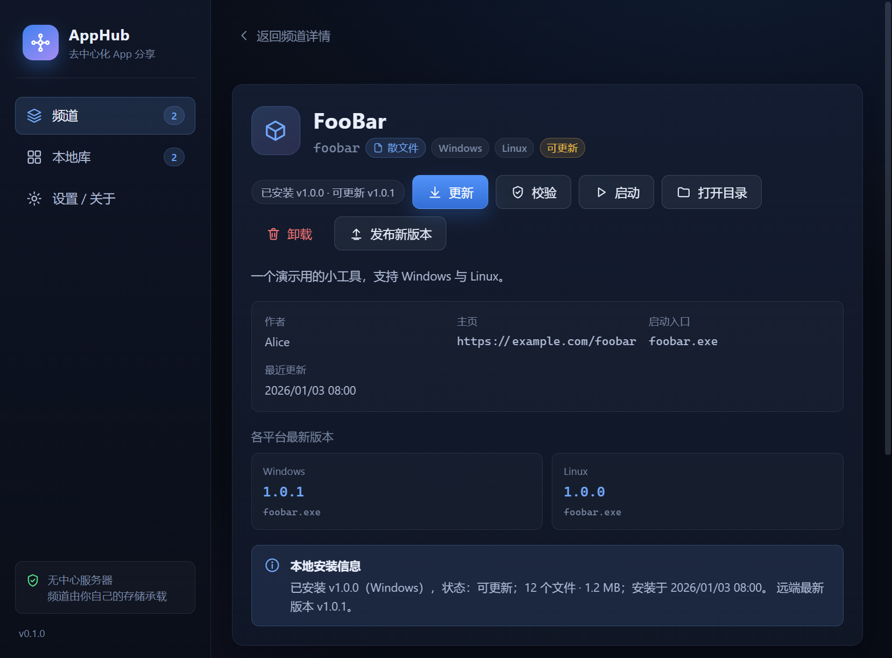
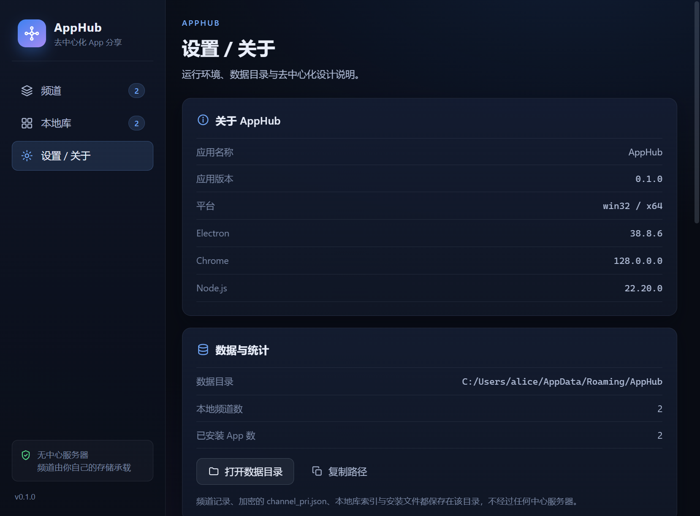
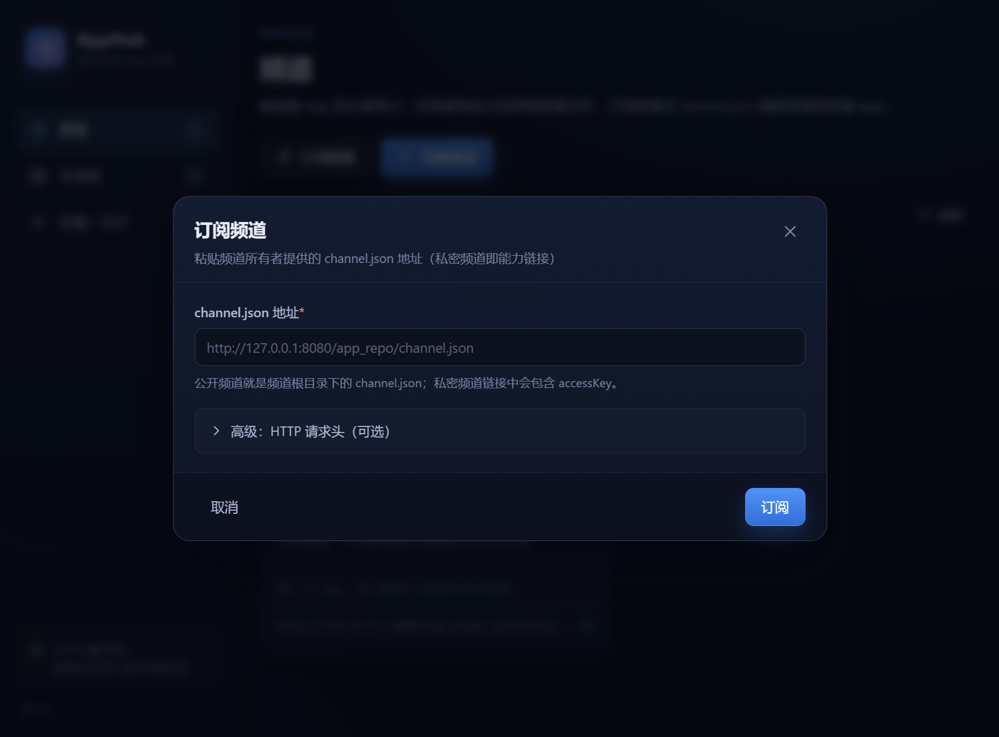
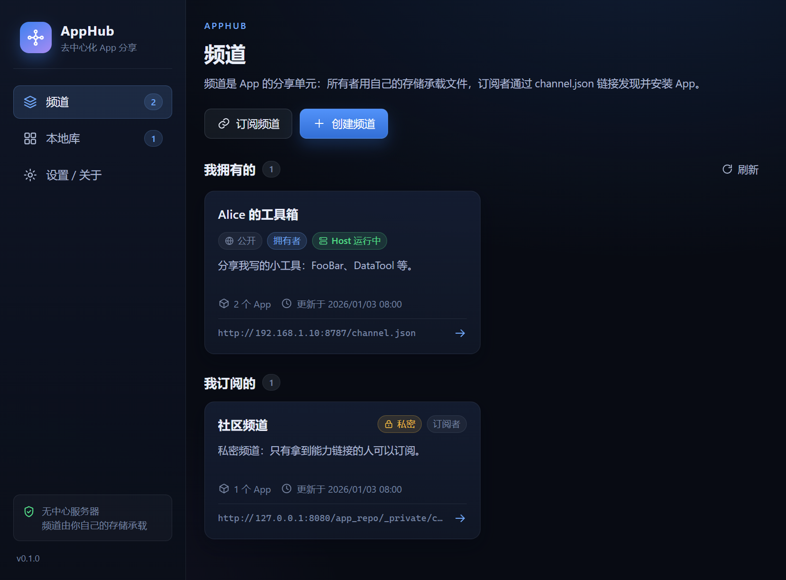

# 界面截图

[← 返回 README](../README.md)

截图来自真实 Electron 构建产物（960px 窗口，演示数据）。

| 频道列表 | 频道详情 |
| --- | --- |
|  |  |

| App 详情 | 发布向导 |
| --- | --- |
|  |  |

| 本地库 | 设置 / 关于 |
| --- | --- |
|  |  |

| 订阅对话框 | 频道列表 Host 徽标 |
| --- | --- |
|  |  |

| 本机 Host 面板（局域网分享） | 创建 local-host 频道 |
| --- | --- |
|  |  |
